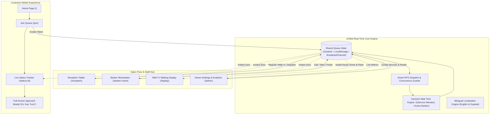

# Product Requirements Document (PRD) & Project Brief
## Real-Time Salon Queue Management System

- **Project Name**: GlamourSync (Real-Time Salon Queue & Floor Management)
- **Tech Stack**: React 18, Vite, Tailwind CSS, Lucide Icons, Web Audio API, BroadcastChannel / LocalStorage Sync
- **Target Deployment**: Vercel / Netlify (Zero-configuration Single Page Application)
- **Document Version**: 1.0.0 (Production-Grade Specification)
- **Status**: Approved for Engineering

---

## 1. Executive Summary & Vision

High-end and high-volume salons face severe operational friction during peak periods (particularly weekends and evenings). The conventional walk-in model leads to crowded waiting areas, customer uncertainty, verbal disputes over queue sequence, and high walk-away abandonment rates. 

**GlamourSync** is a dedicated real-time queue orchestration and floor management web application engineered specifically for modern unisex salons, barbershops, and beauty studios. It bridges the physical salon floor with remote customer mobile devices. Customers can join the live queue remotely or as walk-ins at reception, monitor dynamic estimated wait times in real time, receive approaching-turn notifications, and arrive right on schedule. 

Stylists and barbers manage their chairs through dedicated zero-friction workstation dashboards, the front desk receptionist maintains overall lobby velocity, and the waiting area wall-mounted TV delivers transparent, audio-visual queue dispatches. The entire system is localized in **English** and **Gujarati** to ensure seamless adoption by regional clientele and salon staff.

---

## 2. Problem Statement

### 2.1 The Customer Dilemma
- **Unpredictable Physical Waiting**: Customers routinely wait 45 to 90 minutes on physical salon sofas without any visibility into when their service will actually begin.
- **Queue Abandonment**: Frustrated customers leave without notice to visit competing salons, resulting in permanent revenue loss.
- **Lost Personal Time**: Customers are chained to the salon lobby instead of running nearby errands, grabbing coffee, or waiting comfortably at home.
- **Lack of Transparency**: Customers suspect favoritism or jumping the queue when other patrons are called ahead of them, causing friction with salon staff.

### 2.2 The Salon Operations Dilemma
- **Front-Desk Chaos**: Receptionists are overwhelmed manually juggling clipboards, paper register notebooks, incoming phone calls, and anxious customer queries ("How much longer?").
- **Barber Idle-Time vs. Bottlenecks**: Barbers frequently experience uneven workload distribution. When a customer steps out to smoke or buy coffee and misses their turn, the barber's chair sits idle while the next customer is tracked down.
- **Concurrency & Chair Collisions**: Lack of real-time status sync between the receptionist and individual styling chairs leads to accidental double-booking or assigning customers to stylists who are taking a scheduled break.
- **No-Show Revenue Leakage**: When customers abandon the physical wait without informing staff, queue calculations become corrupted and stylists waste precious chair minutes waiting for ghost customers.

---

## 3. Target Users & Personas

| Persona | Role | Key Motivations | Primary Interface | Device Context |
| :--- | :--- | :--- | :--- | :--- |
| **Priya / Aarav** *(Remote Customer)* | End User | Join queue before leaving home; track wait time dynamically; arrive just in time. | `/`, `/join`, `/status/:id` | Personal Mobile Phone (iOS/Android Safari/Chrome) |
| **Ramesh** *(Walk-in Customer)* | End User | Walk into salon spontaneously; receive a clear token; watch progress on lobby TV. | Reception Kiosk / TV Display | Physical Lobby, Wall TV (`/display`), SMS-free URL token |
| **Neha** *(Salon Receptionist)* | Operations Staff | Fast walk-in registration (< 15s); resolve customer inquiries; manage no-shows and queue flow. | `/reception` | 10"–12" iPad / Android Tablet on Front Desk Counter |
| **Sameer / Vikram** *(Stylist / Barber)* | Service Provider | See who is next; one-click call customer; track service duration; pause for breaks. | `/barber/:name` | Mounted Smartphone / Tablet at Barber Station Mirror |
| **Rajesh** *(Salon Owner / Manager)* | Business Owner | Real-time salon throughput; control queue capacity; manage service menu, prices, and stylist roster. | `/admin` | Laptop / Desktop / Tablet Office Browser |

---

## 4. Project Objectives & Core Success Metrics

1. **Elimination of Lobby Overcrowding**: Reduce physical lobby dwell time by 65% through remote check-in and dynamic approach warnings.
2. **Sub-Second Cross-Device Synchronization**: Ensure real-time queue position and status changes propagate across all connected devices (Customer Mobile, Reception Tablet, Barber Workstation, Wall TV) in **< 1.0 second** locally, and **< 5.0 seconds** across remote connections.
3. **100% Deterministic Smart FIFO Routing**: Eliminate verbal disputes through algorithmic dispatch that respects barber-affinity while optimizing throughput via "Any Barber (Fastest)" routing.
4. **Zero SMS API Dependencies & Costs**: Eliminate carrier SMS costs, DLT registration bottlenecks, and delivery failures by utilizing persistent, bookmarkable web-based tracking URLs (`/status/:id`).
5. **Frictionless Bilingual Inclusivity**: Provide complete, culturally accurate **Gujarati (ગુજરાતી)** and **English** localization across 100% of public customer screens and operational dashboards.
6. **Zero Concurrent Chair Allocation**: Strict system guard preventing more than one active customer per barber chair at any given instant.

---

## 5. Scope & Boundary Definitions

### 5.1 In-Scope Deliverables (Core MVP)
- **Customer Mobile Module**:
  - Landing page with live salon status (Open/Closed, Barbers Active, Current Queue Length).
  - Remote Join Queue form: Full Name, 10-digit Mobile Number, Multi-Service Selection (Max 3), Barber Preference Selection ("Specific Barber" or "Any Barber (Fastest)").
  - Active Duplicate Phone Guard (blocks a second queue entry if an active token is already in progress).
  - Live My Status Tracker (`/status/:id`) with real-time countdown ETA, dynamic queue position, service summary, and progress bar.
  - Full-screen "It's Your Turn!" approach modal with sound alert and device vibration when position reaches 1 or status transitions to `CALLED`.
  - Self-service cancellation modal with instant queue recalculation.
- **Receptionist Tablet Dashboard**:
  - Dual-column responsive layout optimized for 10"–12" tablets.
  - Rapid Walk-in Customer Registration modal (< 15 seconds token creation).
  - Live Queue List with real-time filter by Barber or Status.
  - Operational controls: Manual Call, Force Complete, Mark No-Show, Cancel, and Drag-to-Reorder.
  - 10-Minute No-Show Grace Period guard with countdown timer and automated ejection.
- **Barber Workstation View**:
  - Station dashboard accessed via `/barber/:name`.
  - Barber break toggle (`Available` vs `On Break`).
  - Active Service Station card displaying current customer, service list, elapsed service stopwatch, and `Done (Complete Service)` button.
  - "Next Customer" queue card displaying the next eligible customer according to Smart FIFO rules, with a single-click `Call Next` button.
  - Guard rule preventing calling next customer while a service is currently active.
- **Waiting Area Wall TV Display**:
  - 1080p landscape non-scrolling dashboard optimized for 43"–65" wall TVs.
  - Split-view layout: Left side displays active Barber Station cards (Barber Name, Photo, Status, Customer Currently Serving); Right side displays Upcoming Queue List.
  - Animated high-contrast flash notification and audible Web Audio chime whenever any barber calls a new token.
  - Real-time digital clock, date, and bilingual rolling announcements ticker.
- **Owner Admin & Analytics View**:
  - Master Queue Switch (Emergency Pause / Resume Queue).
  - 30-Minute Auto-Cutoff Rule (automatically closes queue 30 minutes before salon closing time or when backlog exceeds daily capacity).
  - Service Menu Manager (Create, Edit, Delete services, durations in minutes, and INR prices).
  - Barber Roster Manager (Add/Edit barbers, chair assignments, photos/avatars, and active status).
  - Live and daily analytics: Total customers served, average wait time, peak hours, revenue generated, and no-show count.
- **Centralized Localization Engine**:
  - Bilingual dictionary covering English and Gujarati for all UI elements, status labels, service names, and notifications.
  - Persistent language toggle switch stored in browser state.

### 5.2 Strictly Out-of-Scope (Non-Goals)
To guarantee a rock-solid, production-ready system without unnecessary complexity or recurring operating expenses, the following are explicitly excluded from this phase:
- ❌ **No Online Payment Gateways**: No Razorpay, Stripe, or UPI integrations. In-salon billing and cash/card settlement are performed at reception upon service completion.
- ❌ **No Future Calendar Appointments**: No slot booking for tomorrow or next week. GlamourSync is strictly a **same-day real-time live queue** engine.
- ❌ **No SMS or WhatsApp Cloud API Dependencies**: No paid third-party messaging integrations. Tracking is handled purely through the customer's live web URL, eliminating carrier fees, OTP friction, and delivery delays.
- ❌ **No Complex Loyalty or Marketing Systems**: No discount coupons, points systems, referral rewards, or marketing blast modules.
- ❌ **No Multi-Branch Multi-Tenant SaaS**: Single-salon instance configuration.

---

## 6. Functional Architecture & Information Architecture

---

## 7. Core Feature Specifications Matrix

| Module | Feature | Business Rule / Guard | Error Handling / Feedback |
| :--- | :--- | :--- | :--- |
| **Customer** | Remote Queue Join | Max 3 services selected; valid 10-digit phone number. | Validation toast; submit button disabled until valid. |
| **Customer** | Duplicate Phone Check | Phone cannot match any token in `WAITING`, `CALLED`, or `IN_SERVICE`. | Inline modal: "Active token already exists (T-102). Track here." |
| **Customer** | Live ETA Countdown | Calculated based on active barbers and services ahead. | Dynamic refresh every 10s; badge turns coral when 1 ahead. |
| **Customer** | Approach Notification | Triggered when 1 person ahead or token is `CALLED`. | Full-screen modal, 800Hz Web Audio chime, device vibration. |
| **Customer** | Self-Cancellation | Customer can withdraw from queue before service starts. | Confirmation modal required; frees queue slot immediately. |
| **Reception** | Walk-in Check-in | Rapid entry form; auto-generates next sequential token (e.g., T-105). | Form clears and gives tactile success toast in < 15s. |
| **Reception** | No-Show Grace Period | 10-minute timer started upon `CALLED` transition. | Visual countdown bar; ejects to `NO_SHOW` on expiry. |
| **Barber** | Smart FIFO Dispatch | Clicking "Call Next" pulls oldest token for this barber OR "Any Barber". | Skips tokens waiting specifically for other barbers. |
| **Barber** | Chair Concurrency Guard | Cannot call a customer if current chair status is `IN_SERVICE`. | "Call Next" button disabled until active service is marked `Done`. |
| **Barber** | Break Toggle | Barber switches to `On Break` status. | Excluded from $N_{\text{active}}$ in wait time formula; cannot be assigned tokens. |
| **TV Display** | Split-Screen Grid | Left: 4 Barber Station cards; Right: Upcoming Queue. | 1080p fixed layout; zero vertical scrolling required. |
| **TV Display** | Call Chime & Flash | Active barber card pulses coral; 2-tone melodic chime plays. | Web Audio API synthesized chime (zero external audio file dependencies). |
| **Admin** | Master Queue Toggle | Instantly closes queue to new joins while preserving active tokens. | Join button shows "Queue Temporarily Paused". |
| **Admin** | 30-Min Auto-Cutoff | Automatically stops accepting joins 30 mins before salon close. | Banner notice displayed on `/` and `/join`. |
| **Admin** | Roster & Menu Config | CRUD operations on services and staff roster. | Instant update in persistent store and UI across all tabs. |
| **System** | Bilingual Support | Header language toggle switches between English (`en`) and Gujarati (`gu`). | 100% dictionary coverage; language choice saved in local storage. |
