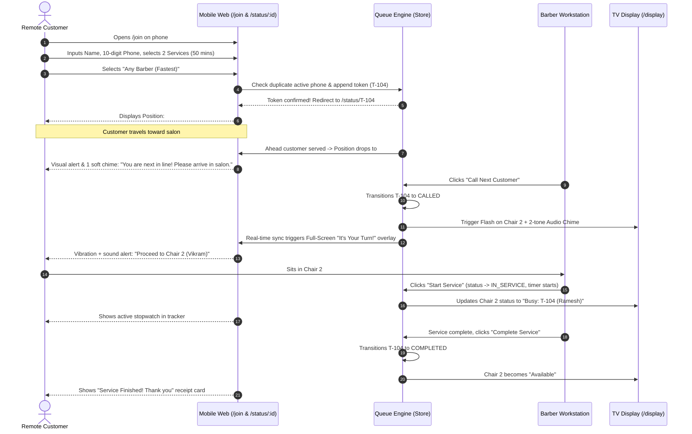
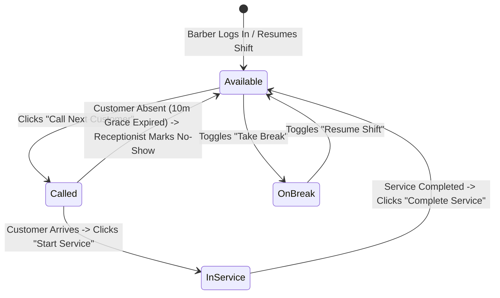

# System Business Logic, Workflows & Rule Specifications
## Real-Time Salon Queue Management System

- **Document Version**: 1.0.0
- **Scope**: Algorithmic rules, queue state transitions, wait time formulas, lifecycle scenarios, and end-to-end verification checklist.

---

## 1. Step-by-Step Scenario Walkthroughs

---

### Scenario 1: Main Remote Customer Flow



#### Detailed Execution Steps
1. **Access & Details Entry**: Customer accesses `/join` from home or mobile browser. Inputs full name, 10-digit mobile number, selects up to 3 services, and selects either "Any Barber (Fastest)" or a specific stylist.
2. **Duplicate & Capacity Check**: System validates that no active token exists for this phone number and that the Master Queue is open. Token `T-104` is generated and assigned state `WAITING`.
3. **Live Status Tracking**: Customer is navigated to `/status/T-104`. The view displays dynamic queue position, estimated remaining wait time, and progress bar.
4. **Approaching Turn Warning (Position #1)**: When queue progression brings the customer to position #1, the interface turns warm coral, triggers a soft reminder chime, and instructs the customer to enter the salon lobby.
5. **Call Notification**: Barber clicks `Call Next`. Token status shifts to `CALLED`. Customer device triggers full-screen modal with continuous audio chime and device vibration, directing them to the specific chair number.
6. **In-Chair Service**: Customer enters chair; stylist clicks `Start Service`. Token transitions to `IN_SERVICE`. Chair timer begins counting up.
7. **Service Completion**: Stylist clicks `Complete Service`. Token transitions to `COMPLETED`. Customer tracker displays thank-you message and pricing summary. Chair is released back to `AVAILABLE`.

---

### Scenario 2: Walk-In Customer Flow at Reception

1. **Lobby Arrival**: Customer walks into the salon without prior booking or remote registration.
2. **Receptionist Intake**: Receptionist opens `+ Walk-In Registration` modal on the desk tablet (`/reception`).
3. **Rapid Data Input (< 15 seconds)**:
   - Receptionist enters Customer Name (or taps "Walk-in Guest").
   - Enters Mobile Number (optional for walk-ins).
   - Taps quick-service chips (e.g. "Haircut 30m").
   - Selects Barber Preference ("Any" or specific stylist requested).
4. **Token Generation & Queue Tail Insertion**:
   - Receptionist taps `Issue Token`.
   - Engine assigns the next chronological token ID (e.g., `T-105`) and sets status to `WAITING`.
   - Token is appended **strictly to the end** of the FIFO queue.
5. **Customer Visibility**:
   - Customer can scan the on-screen QR code from reception or wall TV to track on their mobile phone, or simply relax in the lobby watching the Wall TV (`/display`).

---

### Scenario 3: Barber Workstation Lifecycle



1. **Shift Login & Chair Assignment**: Barber opens `/barber/:name` on workstation tablet. State is initialized as `AVAILABLE`.
2. **Next Customer Dispatch**: Barber views the top recommended customer card (selected via Smart FIFO). Barber taps `Call Next Customer`.
3. **Active Calling Phase**: Chair shows `CALLED: T-103`. Wall TV chimes, customer phone alerts. If customer enters within 10 minutes, barber taps `Start Service`.
4. **Service Phase**: Status shifts to `IN_SERVICE`. Stopwatch counts elapsed time (`14:22`). Chair concurrency guard is active: the "Call Next" button is disabled until the current customer is finished.
5. **Completion Phase**: Barber taps `✓ Complete Service`. Token is archived to `COMPLETED`. Chair resets to `AVAILABLE`.
6. **Break Handling**: If barber needs lunch or tea break, they toggle `Take Break`. The chair displays `ON_BREAK`, and the wait time algorithm automatically decrements active barbers count ($N_{\text{active}}$) by 1.

---

### Scenario 4: No-Show Handling & Recovery

```
  [ Token Called ] ──────> [ 10-Min Grace Timer Starts (09:59) ]
                                      │
              ┌───────────────────────┴───────────────────────┐
              ▼                                               ▼
     Customer Arrives (<10m)                       Timer Hits 00:00 (No-Show)
  Barber taps "Start Service"                      Receptionist clicks "Mark No-Show"
              │                                               │
              ▼                                               ▼
       [ IN_SERVICE ]                              Token status -> [ NO_SHOW ]
                                                   Chair freed -> Next called
                                                              │
                                                   Customer arrives later?
                                                              ▼
                                                   Reception clicks "Re-Add"
                                                   -> NEW Token at TAIL of queue
```

1. **Grace Period Activation**: The moment a token transitions to `CALLED`, an automatic `calledAt` timestamp is recorded, initiating a **10-minute grace period** (`10:00` counting down).
2. **Visual Timer at Reception**: The receptionist tablet displays a decreasing orange timer bar for that token.
3. **Absence & Ejection**: If 10 minutes elapse without customer arrival, the receptionist or barber clicks `Mark No-Show`. Token status updates to `NO_SHOW` and is ejected from the active queue. The chair returns to `AVAILABLE`.
4. **Late Arrival Recovery**: If the customer arrives late (e.g. 15 minutes after being called):
   - The receptionist clicks `Re-Add Customer` from the No-Show log.
   - The system **strictly issues a fresh token** (e.g. `T-109`) and appends them to the **tail end** of the line.
   - Guard Rule: Under no circumstances is a no-show allowed to jump back into their previous slot ahead of waiting customers.

---

### Scenario 5: Customer Cancellation

1. **Customer Decision**: A waiting remote customer decides they can no longer attend.
2. **Initiation**: From `/status/:id`, customer taps `Cancel My Spot`.
3. **Confirmation Modal**: A safety sheet appears: *"Are you sure? You will lose position #2."*
4. **Queue Recalculation**: Customer confirms. Token status updates to `CANCELLED`.
5. **Instant Recalculation**:
   - The cancelled token is removed from active FIFO calculations.
   - All subsequent tokens in line immediately see their queue position improve by 1.
   - Wait times dynamically update across all devices within < 1 second.

---

## 2. Queue State Machine & Transition Invariant Rules

### 2.1 State Transition Matrix

| Current State | Target State | Allowed Actor(s) | Triggering Event / Action | Strict Pre-Condition Guard |
| :--- | :--- | :--- | :--- | :--- |
| `[INIT]` | `WAITING` | Customer / Reception | Remote Join or Walk-In Registration | Phone number has no active token; Master Queue is Open. |
| `WAITING` | `CALLED` | Barber / Receptionist | Click "Call Next" | Barber chair is `AVAILABLE`; Token matches Barber or is `ANY`. |
| `WAITING` | `CANCELLED` | Customer / Reception | Click "Cancel Spot" | Confirmation modal accepted; Service has not started. |
| `CALLED` | `IN_SERVICE` | Barber / Receptionist | Click "Start Service" | Customer present in salon; Chair is physically occupied. |
| `CALLED` | `NO_SHOW` | Receptionist / Barber | Click "Mark No-Show" | 10-minute grace timer expired or confirmed absent. |
| `CALLED` | `CANCELLED` | Customer / Reception | Click "Cancel Spot" | Customer declines or leaves salon before chair seating. |
| `IN_SERVICE` | `COMPLETED` | Barber / Receptionist | Click "Complete Service" | Service completed; bill cleared. |
| `NO_SHOW` | `WAITING` (New) | Receptionist | Click "Re-Add Customer" | Creates brand-new token appended strictly at queue tail. |

### 2.2 Strict Invariant Rules (Guards)
1. **No Backwards State Jumps**: A token in `COMPLETED`, `CANCELLED`, or `NO_SHOW` can **never** transition back to `IN_SERVICE`, `CALLED`, or `WAITING`.
2. **Chair Concurrency Guard**: A barber chair can have **at most one** token in `IN_SERVICE` or `CALLED` state simultaneously. Calling a customer is blocked if the chair already has an active customer.
3. **Pre-requisite Call Guard**: A token **cannot** jump directly from `WAITING` to `IN_SERVICE`. It must pass through `CALLED` to ensure lobby alert and TV chime are triggered.
4. **Duplicate Active Phone Guard**: At any point in time, a phone number can be associated with only **one** token in active status (`WAITING`, `CALLED`, or `IN_SERVICE`).

---

## 3. Smart FIFO Queue Dispatch Algorithm

When Barber $X$ clicks **"Call Next Customer"**, the system does not simply take the top token. It executes an intelligent FIFO matching algorithm:

```typescript
function getNextEligibleCustomer(
  queue: Token[], 
  barberId: string
): Token | null {
  // 1. Filter only tokens currently in WAITING status
  const waitingTokens = queue.filter(t => t.status === 'WAITING');

  // 2. Scan sequentially (FIFO order) for first eligible match
  for (const token of waitingTokens) {
    // Condition A: Customer requested this exact barber
    if (token.preferredBarberId === barberId) {
      return token;
    }
    // Condition B: Customer requested "Any Barber (Fastest)"
    if (token.preferredBarberId === 'ANY') {
      return token;
    }
    // Condition C: Customer requested a different barber (barberId !== X)
    // -> Skip this token and evaluate next in line!
  }

  return null; // No eligible customers waiting
}
```

### Example Dispatch Walkthrough:
- Queue line:
  - `T-101`: Requested **Barber Vikram**
  - `T-102`: Requested **Barber Sameer**
  - `T-103`: Requested **Any Barber**
  - `T-104`: Requested **Barber Vikram**
- **Action**: Barber **Sameer** clicks "Call Next".
- **Algorithm Execution**:
  - Checks `T-101`: Wants Vikram $\rightarrow$ **Skip**.
  - Checks `T-102`: Wants Sameer $\rightarrow$ **Match!**
  - Result: `T-102` is called. `T-101` retains its position at the head of Vikram's queue.

---

## 4. Dynamic Wait Time Formula & Zero-Barber Fallback

### 4.1 Mathematical Formulation

The dynamic estimated wait time $W_k$ (in minutes) for customer $k$ in the queue is governed by:

$$W_k = \frac{\sum_{i=1}^{k-1} D_i + \sum_{b=1}^{N_{\text{active}}} R_b}{N_{\text{active}}}$$

Where:
- $D_i$: Total duration (minutes) of selected services for customer $i$ waiting ahead in line.
- $R_b$: Remaining estimated service minutes for barber chair $b$ currently serving a customer ($R_b = \max(0, \text{TotalDuration}_b - \text{ElapsedMinutes}_b)$).
- $N_{\text{active}}$: Total count of barbers currently **On Duty and Available** (excluding any barbers on break or off-duty).

#### Specific Barber Wait Calculation
If a customer selects **Specific Barber $X$**, the wait time formula restricts the pool strictly to Barber $X$:

$$W_{k, X} = R_X + \sum_{j \in \text{Ahead for } X} D_j$$

Where the sum includes all customers ahead who chose Barber $X$, plus any "Any Barber" customer who will be assigned to $X$ before customer $k$.

---

### 4.2 Zero-Barber Fallback Guard

When $N_{\text{active}} = 0$ (all barbers are either on break, stepped out, or offline):
1. **Wait Time Display Fallback**:
   - Instead of dividing by zero or showing `NaN` / `Infinity`, the system renders:
   - English: `"Queue Paused (All Stylists on Break)"`
   - Gujarati: `"કતાર થોભાવેલ છે (તમામ કારીગરો બ્રેક પર છે)"`
2. **Status Tracker Badge**:
   - Changes from green/amber to a soft rose warning badge with a coffee-cup icon.
3. **Queue Join Restriction**:
   - The `/join` page shows an ambient warning notice: *"All stylists are currently taking a scheduled break. You may still join, but wait times will begin once stylists resume."*

---

## 5. Duplicate Active Phone Guard Logic

```typescript
function validatePhoneUniqueness(
  phone: string, 
  activeTokens: Token[]
): { isAllowed: boolean; existingTokenId?: string } {
  // Normalize: Strip spaces, dashes, +91 country prefix
  const cleanPhone = phone.replace(/\D/g, '').slice(-10);

  if (cleanPhone.length !== 10) {
    return { isAllowed: false };
  }

  const existing = activeTokens.find(token => {
    const tokenPhone = token.phone.replace(/\D/g, '').slice(-10);
    return (
      tokenPhone === cleanPhone &&
      ['WAITING', 'CALLED', 'IN_SERVICE'].includes(token.status)
    );
  });

  if (existing) {
    return { isAllowed: false, existingTokenId: existing.id };
  }

  return { isAllowed: true };
}
```

---

## 6. 15-Point End-to-End Verification Test Checklist

| # | Test Case / Scenario | Test Input / Action | Expected Result & Verification Criteria | Pass / Fail |
| :-: | :--- | :--- | :--- | :-: |
| **1** | **Remote Join Validation** | Submit `/join` with empty name, 9-digit phone, 0 services. | Submit button is disabled. Form highlights missing inputs. | `[ ]` |
| **2** | **Max 3 Services Guard** | Select 3 services in `/join`, then click a 4th service. | 4th service cannot be checked; tooltip displays "Maximum 3 services allowed". | `[ ]` |
| **3** | **Duplicate Phone Guard** | Join with `9825012345`. Re-open `/join` and attempt join with `9825012345`. | Blocked with inline error: "Active token already exists (T-XXX). Track here." | `[ ]` |
| **4** | **Smart FIFO Barber Affinity** | Queue: T-1 (Barber A), T-2 (Barber B), T-3 (Any). Barber B clicks "Call Next". | Barber B receives T-2 (not T-1). T-1 remains #1 in line for Barber A. | `[ ]` |
| **5** | **"Any Barber" Allocation** | Queue: T-1 (Any), T-2 (Barber A). Barber B clicks "Call Next". | Barber B receives T-1 immediately. | `[ ]` |
| **6** | **Chair Concurrency Lock** | Barber has active customer in `IN_SERVICE`. | "Call Next Customer" button is disabled and locked until current service is `Done`. | `[ ]` |
| **7** | **Workstation Timer Cycle** | Barber clicks "Start Service" on called customer. | Stopwatch timer starts ticking upward from `00:00`. Status shifts to `IN_SERVICE`. | `[ ]` |
| **8** | **Service Completion** | Barber clicks "Complete Service". | Token marked `COMPLETED`. Chair resets to `AVAILABLE`. Stats increment in admin. | `[ ]` |
| **9** | **Walk-In Registration** | Receptionist submits walk-in modal with 1 service. | Next token generated (e.g. T-109) and appended strictly to the bottom of the queue. | `[ ]` |
| **10**| **No-Show Grace Period** | Token called; 10-minute timer starts. Receptionist clicks "Mark No-Show". | Token status updates to `NO_SHOW`. Active queue recalculates. Chair freed. | `[ ]` |
| **11**| **No-Show Re-Add Rule** | Receptionist clicks "Re-Add Customer" on expired no-show. | Customer receives brand-new token at the TAIL of the queue (never jumps forward). | `[ ]` |
| **12**| **Customer Self-Cancel** | Customer in queue clicks "Cancel My Spot" on `/status/:id`. | Confirmation prompt shown; upon confirmation, token cancelled, others shift up by 1. | `[ ]` |
| **13**| **TV Display Call Alert** | Barber clicks "Call Next" on workstation. | Wall TV highlights chair in coral flash and plays 2-tone Web Audio chime. | `[ ]` |
| **14**| **Zero-Barber Break Guard** | All barbers set status to "On Break". | Status tracker shows "Queue Paused (All Stylists on Break)". Zero division avoided. | `[ ]` |
| **15**| **Cross-Device Sync & Bilingual**| Update status on Barber screen; view Reception, TV, Customer. Toggle EN/GU. | Status reflects across tabs in < 1s. All text instantly switches English ↔ Gujarati. | `[ ]` |
